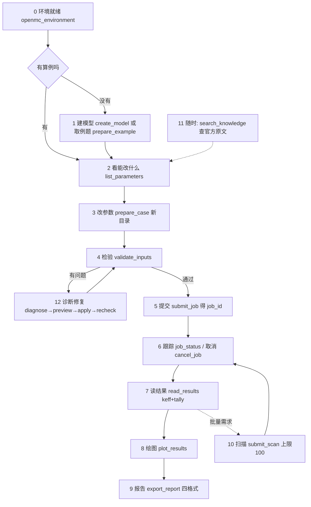

# 10 · 架构梳理与用户视角流程

- 日期：2026-11-03　对象：mc-tech-execution 0.8.0　证据：mcp/ 40 个模块的文件头职责注释与源码抽读、双环境实测（mcp/.venv 与 .runtime/openmc 分别内省）、api() 桥源码、真实作业目录（b9ef8754/dfc4633c）逐文件清单、工具注册表实测（TOOLS=37）。

> 更新记录（2026-11-03，0.9.0）：正文各处"37 个工具"为 0.8.0 实测值，按历史措辞保留。0.9.0 注册表增至 43 个：新增 openmc_inspect_step、openmc_convert_cad（CAD→DAGMC 转换）、openmc_build_dagmc_model（DAGMC 可运行模型组装）、openmc_preview_input（提交前预览）、openmc_job_compare（作业对比第一刀）、openmc_storage_report（内部记录存储只读报告与可回收量预览）；openmc_validate_inputs 增加 semantic_check 静态语义校验（统一 problems 定位清单：密度正定/单位合法、温度正定、核素/S(a,b) 对照生效截面索引、tally filter 定义与 <filters> 引用完整性）与 geometry_check 几何重叠检查（openmc -g 在临时副本上削减批次运行，重叠单元结构化返回，概率性结论如实标注）；openmc_job_status 返回结构化 progress 节（批次/k/Combined k/耗时）；openmc_prepare_case 返回逐参数前后差异与写入后读回验证（parameter_diff.verified）。详见 CHANGELOG 0.9.0。
- 回答的问题：① 架构清不清晰？② 用户视角每一步发生了什么、底层到底在做什么？③ 还有什么该补充的？
- 与仓库既有文档的关系：`docs/inputs.html#source` 已有"一次请求怎样走完/源码职责"（HTML 手册，`docs/架构与扩展.md` 只是指向它的存根）。本文补上它没有的：分层图、双环境实证、用户视角逐步表、架构级扩展点清单。建议并入仓库 docs/（已同步一份）。

## 0. 架构清不清晰？——判断先行

**骨架清晰，且有硬证据；不清晰的是"面"：模块多、命名风格杂、三条例题子系统并存、架构文档薄。**

清晰的证据（都实测过，不是读文档读出来的）：

1. **单注册表、双入口**：37 个工具全部出自 `tools.py` 一份注册表；CLI（`cli.py`，自述"与 MCP 使用同一注册表和 schema 校验"）和 MCP 服务（`server.py`，通用宿主，"customize tools.py"）共用它。同一行为两个门面，测一处即测两处（tests/test_tool_contracts.py 专测契约）。
2. **双 Python 环境 + 子进程 JSON 桥**：接口环境 `mcp/.venv`（Python 3.14.4）**实测无 openmc**；计算环境 `.runtime/openmc`（Python 3.12.16 + OpenMC 0.16.0）。所有需要 openmc 的操作经 `openmc_runtime.api()` 以子进程调 `openmc_worker.py`：stdin 进 JSON（带 `_expected_version` 版本哨兵 + 字体路径），stdout 出 JSON，超时/非零退出/非 JSON 都有明确报错。**表 4-1 §2.1"运行期不装 openmc"的分层意图实际达成**——引擎升级不动接口层，接口层崩溃不伤计算现场。
3. **作业即目录、产物即证据**：每次提交在 `workspace/.mc-jobs/<32位hex>/` 落一套自包含记录（见 §4），原子 JSON 写 + flock 文件锁 + sha256 指纹（provenance）+ 重启后可查询（实测过服务重启查询）。
4. **边界防御成体系**（散在各模块，方向一致）：路径必须在工作区内（path_in_workspace）；只杀自己拥有的进程（owned_processes，"never signal by name"）；复制算例拒符号链接、拒覆盖已有目录；XML 拒 DTD/ENTITY；扫描组合上限（max_scan_cases=100）；日志截断有标记（max_log_bytes）；例题只认注册 ID、拒调用方脚本路径；审计日志对 password/token/api_key 类参数自动打码；修复类 CLI 非交互管道直接拒绝；合成数据全程带 synthetic_mgxs 标记、结果带 `professional_acceptance: False`——**模拟数据不冒充专业结论是写进返回值里的**。

不清晰的点（§6 展开）：40 个模块四种命名风格；例题能力分散在 6 个模块（official_catalog/sources/assets/runner + notebook_runner/runtime/stages + script_workflows + example_workflows）新人难入；api() 桥协议无版本号；仓库内架构文档只有存根+HTML，没有一张图。

## 1. 分层架构图

```
        用户 / 智能体（自然语言）              用户（命令行）
              │                                    │
     MCP 宿主（Claude/Codex/DSH/Helix…）      直接 CLI（mcp/cli.py）
              │ 标准 MCP 协议                     │ 同一注册表+schema校验
              ▼                                    ▼
┌─────────────────── 接口层（mcp/server.py 389行，./start.sh 启动）───────────────────┐
│  tools.py 单一工具注册表（37 工具，9 组）      tool_metadata.py 参数语义（发现/文档共用）  │
│  resources.py 3 个只读资源（参数字典/例题目录/调用审计）   adapters.py 函数/CLI/HTTP 适配器 │
└──────────────────────────────────────┬─────────────────────────────────────────┘
                                       ▼   业务层 —— 接口环境 mcp/.venv（Python 3.14，无 openmc）
│ openmc_tools   环境探测/输入校验/建模入口/读结果/报告入口      openmc_jobs    作业状态机+持久记录（291行）│
│ openmc_scan    串行参数扫描（上限保护/两级作业）               openmc_parameters 参数发现与受限修改     │
│ openmc_diagnostics 证据定位诊断+窄修复链                      business      修复四步/知识/内置算例      │
│ openmc_plots / openmc_reports / openmc_artifacts / openmc_knowledge                          │
│ owned_processes 进程所有权（跨会话只杀自己的）    openmc_runtime 配置+工作区边界+api()桥      │
└──────────────────────────────────────┬─────────────────────────────────────────┘
                     api(action, dir, payload)  子进程 + stdin/stdout JSON + 版本哨兵
                                       ▼   计算层 —— .runtime/openmc（Python 3.12 + OpenMC 0.16.0 dagmc_nompi）
│ openmc_worker  Model 解析/生成/校验/参数写回（对象模型 export_to_xml）                        │
│ openmc_visuals 无头绘图（StatePoint→matplotlib，字体/误差条）    nuclear_data 核数据缓存管理   │
│ openmc CLI：openmc（输运）/ -g（几何调试）/ -p（绘图）   deplete/lib/mgxs（工作流内部）        │
└──────────────────────────────────────┬─────────────────────────────────────────┘
                                       ▼   存储层 —— workspace/（一切产物本地，无远程下载）
   .mc-jobs/<32hex>/   job.json·runtime.json·solver.log·record.lock·work/（输入+产物+images/）
   .mc-scans/<32hex>/  job.json·baseline/·cases/<i>/·summary.json·summary.csv
   算例目录/           materials.xml·geometry.xml·settings.xml·tallies.xml·mc-case.json
```

例题体系（挂在业务层旁）：`official_catalog`（50 项固定清单：13 主仓工作流 + 9 内置模型 + 28 notebook）→ `official_sources/assets`（取源与资产）→ 三条执行线：`script_workflows`（主仓工作流）、`official_runner`（内置模型）、`notebook_runner/runtime/stages`（notebook 分阶段执行，保留每步输入/原始结果/图形）；`example_workflows` 是统一的逐步实例状态机（prepare/run_step/status）。

## 2. 用户视角主流程：每一步发生了什么、底层在做什么



| 步 | 用户做什么 | 调什么工具 | 底层到底在做什么 | 留下什么痕迹 |
|---|---|---|---|---|
| 0 | 问"环境好了吗" | openmc_environment | 三路分别探测：求解器可执行（.runtime/openmc/bin/openmc）、Python API（api() 桥试调）、核数据（截面库路径+文件索引）；"装了 Python 包不等于有可执行程序"是设计原话 | 返回版本 0.16.0、build 串、executable_available、version_matches |
| 1a | "给我建个模型" | openmc_create_model | 校验 template∈{pwr-pin-cell, pincell-multigroup, synthetic-mgxs} + 参数为正整数 → api('create') → **worker 在计算环境**用 openmc 对象模型搭 Cell/Geometry/Materials/Settings → export_to_xml 落盘 | 新算例目录 + generation_method=deterministic_public_api_template 标记 |
| 1b | "给我个例题" | openmc_prepare_example / official 系 | 从 50 项固定清单按注册 ID 取输入（拒任意路径/脚本）；缺数据依赖会明确报"缺什么"，不静默降级 | 例题目录 + mc-case.json（来源/步骤/依赖声明） |
| 2 | "这算例能改什么" | openmc_list_parameters | 先 validate_inputs 结构把关 → api('parameters') → worker 用 Model.from_xml 解析 → 按显式白名单发现可调参数（名称/单位/范围/当前值） | 参数清单（p4 实例：27 个） |
| 3 | "把粒子数改成 X" | openmc_prepare_case | check-parameters 先验合法性 → copy_inputs 整目录复制（**拒符号链接、拒覆盖已有目录、剔除旧输出**）→ api('update-parameters') 对象模型写回 XML | 新目录（原算例分毫不动）+ provenance sha256 |
| 4 | "检查一下" | openmc_validate_inputs | 结构层：文件齐否、拒 DTD/ENTITY、根元素对、particles/batches/inactive 范围；可选 api('validate') 升到 openmc 解析器层；自报 validation_level 和"未判定几何重叠/物理正确性" | problems 清单 + validation_level + professional_acceptance=False |
| 5 | "跑" | openmc_submit_job | jobs.submit：建 .mc-jobs/<32hex>/，写 job.json（含输入快照指纹）+ runtime.json（生效配置副本）→ spawn_worker 独立进程（owned_processes 登记所有权）→ 计算环境子进程跑 openmc，stdout/stderr 落 solver.log（超 max_log_bytes 截断有标记） | job_id；**记录跨服务重启存活** |
| 6 | "跑完没"/"停" | openmc_job_status / cancel_job | 读 job.json（record.lock+flock 防撕裂）；状态机 queued→running→completed/failed/cancelled/interrupted；取消=按所有权终止**进程组**（killpg）+清残输出；查询可有界等待 30 秒 | 状态与时间戳全部落 job.json |
| 7 | "keff 多少" | openmc_read_results | 在计算环境用 StatePoint 读 k_combined（mean/std_dev）+ tally 摘要（mean/std_dev，不拿累计和冒充均值），大结果按 max_values 截断并声明 | JSON 摘要 + 产物路径清单 |
| 8 | "画个图" | openmc_plot_results / plot_scan | api() 调 openmc_visuals 在计算环境无头跑 matplotlib（字体路径从配置注入、误差条带上）；扫描曲线从各 case 的 keff 汇总 | PNG/SVG + 服务端绝对路径 |
| 9 | "出报告" | openmc_export_report / export_scan | 四格式：MD/CSV 直写；PDF/DOC(X) 走真实 Office 转换（隔离进程，转换失败如实报错不降级） | 报告文件 + 元数据 + sha256 |
| 10 | "扫 20 组参数" | openmc_submit_scan | axes 校验（有限数值/无重复）→ **组合数≤max_scan_cases(100) 否则拒绝** → .mc-scans/<id>/ 建 baseline+逐 case 目录 → 监控进程**串行**执行：每 case = 复制→改参→提交子作业→等终态→读 keff → summary.json/csv | scan_id + 两级作业记录（scan→case→job_id 都可追） |
| 11 | "这参数啥意思" | openmc_search_knowledge / read_knowledge | 对随包 8 份固定版本官方 RST 原文检索，返回带版本/行号/出处的原文段；未命中不编造 | 引用出处（可回查原文文件） |
| 12 | 出错了 | diagnose_log/job → preview_repair → apply_repair → recheck_repair | 诊断：error-rules.json 6 条规则匹配 + 行号定位 + 官方依据；修复四步：diff 预览→计划（哈希锚定）→**人工确认后**写回（先备份原文件，文件被改过则拒绝执行）→重校验/关联重算；当前自动修复只覆盖 run_mode 拼写一类，其余只给证据不硬修 | 修复计划 + 备份文件 + recheck 结果 |

**每一步都留痕**是这套架构的底色：job.json 记状态史、provenance 记输入指纹、solver.log 记过程、tool-calls 资源记调用（参数值不落审计、凭据形状自动打码）、合成/模拟数据自带标记。

## 3. 两级作业模型（扫描怎么嵌作业）

```
.mc-scans/<scan_id>/
├─ job.json          扫描总记录：axes、cases[i]{index,parameters,state,job_id,keff,error}、active_job_id
├─ record.lock       flock 串行化"取消 vs 提交 vs 记账"
├─ baseline/         源算例副本（只读参照）
├─ cases/0..N-1/     每个组合一个完整算例目录（复制自 baseline 后改参）
└─ summary.json/csv  收尾汇总（scan_id,index,各轴值,state,job_id,keff_mean,keff_std_dev,data_kind,error）
        每个 case 的 state: planned→preparing→running→completed/failed/cancelled/not_run
        每个 running 的 case 同时是一个独立的 .mc-jobs/<job_id>/（完整第 5–7 步痕迹）
取消扫描：置 cancel_requested → 当前子作业按所有权终止 → 未跑的标 not_run → 终态 cancelled/partial
监控进程死亡：status 发现 worker 身份不符 → 标 interrupted，"不自动重新提交"，已有子作业仍可查/可取消
```

## 4. 关键架构决定与后果

| 决定 | 得到什么 | 付出什么 / 边界 |
|---|---|---|
| 单注册表双入口（CLI=MCP） | 行为一致可互证；宿主联调前就能用 CLI 全量测试 | tool_metadata 语义要人肉保持同步 |
| 双环境 + api() 子进程桥 | 接口层免装 openmc（表 4-1 分层意图达成）；引擎崩溃不伤接口；版本哨兵（_expected_version）防环境漂移 | 每调用一次进程开销；**桥协议无版本号**（升级兼容靠哨兵单值） |
| 作业=目录+原子 JSON+flock | 零数据库依赖；重启存活；产物即审计 | 跨作业查询弱；量大后该评估 SQLite（ADR-0001 #3） |
| owned_processes 只杀自己的 | 多用户/多会话机器上安全 | HPC 远程取消是另一套机制，3.2 要新设计 |
| 产物只留服务端、无远程下载 | 边界干净、无出网风险 | HPC 结果取回（3.2）将成为新的架构缺口 |
| 例题三条执行线 + 统一状态机 | 50 个官方入口全覆盖、每步留原始结果 | 6+ 模块的复杂度；新人上手陡 |
| 一切合成/模拟数据带标记 + professional_acceptance=False | "工程验证≠专业验收"从口径变成数据结构 | 报告消费方要理解这些标记 |

## 5. 架构级扩展点（HPC 与第二批往哪接）

1. **执行器抽象（3.2 HPC 的正确接缝）**：现在 `jobs.spawn_worker` 只会起本地进程。HPC 不应新做一套并行体系，而是在 jobs 层抽一个执行器接口：local（现状）/ slurm（sbatch 提交、squeue/sacct 状态映射、结果 scp 取回），job.json 结构、状态机、所有权语义全部复用。**这是 3.2 开工前最值得先画的一张图**，也回答"取回产物"与现有"无远程下载"边界的冲突。
2. **api() 桥加 protocol_version**：payload 已有 _expected_version（引擎版本哨兵），再加桥协议自身版本，双环境独立演进才安全。
3. **建模深度（A1 组件/栅格）**：worker 的对象模型路线直接受益——RectLattice/HexLattice/universe 阵列都是 worker 侧扩展，接口层只加模板名和参数 schema（届时按 ADR-0001 #1 上 Pydantic）。
4. **燃耗工具层（A2/D1）**：deplete 已在计算环境被 notebook 线深度使用，工具化=在 worker 加燃耗动作 + read_results 加 Results 分支，不动架构。
5. **tally 定义（A3）**：同 worker 扩展路径。
6. **知识检索增强（G4）**：只动 openmc_knowledge 内部，接口不变——向量库到位即插。

## 6. 不清晰点与补充建议（"还有什么补充"）

1. **架构文档进仓库**：本文（或其 HTML 化）应并入 docs/，替换"架构与扩展.md 存根→inputs.html"的间接路径；图和第 2 节逐步表是新人最缺的两样。
2. **模块地图一页纸**：40 个模块按 §1 五层归类 + 一句话职责（本文 §1 可直接扩成），放 README 或 docs/index。
3. **命名统一**（需求 G1）：业务层 openmc_*、例题层 official_*/notebook_*/example_*、无前缀的 business/tools/cli/server/resources/adapters——分层看其实有规律，但 7 个无前缀**工具名**（diagnose_log 等）混在 30 个 openmc_* 里对宿主不友好，加前缀+alias 迁移。
4. **桥协议版本化**（§5.2）。
5. **22 个工具未练**＝架构的"用户入口"没被场景驱动过：练手清单（G2）本质是给每个入口补一条真实用户路径，正好用 §2 的表当脚本。
6. **序列图缺位**：扫描两级作业、修复四步链这两处状态机最容易被误用，建议各补一张时序图进手册（本文 §3 是扫描的文字版）。

## 7. 结论

架构设计的清晰度**高于文档呈现的清晰度**：分层、边界、审计三条线在代码里是一致贯彻的（40 个模块的文件头注释几乎每个都在声明自己的边界），但仓库里没有一张图把这件事讲给新人和甲方听。本文补的就是这一张图和一张表。下一步优先级：HPC 执行器抽象设计（§5.1）> 架构文档入库（§6.1）> 命名统一（§6.3）。
